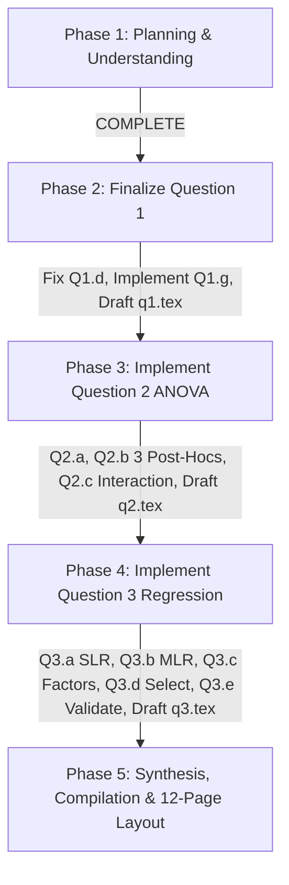

# SMDE Homework 1 — AI Assistant Project State & Action Plan

This document is the master project tracker, status log, and roadmap for the AI assistant across all phases of **SMDE Homework Assignment 1 (Questions 1, 2, and 3)**.

---

## 1. Project Overview

| Detail | Description |
| :--- | :--- |
| **Course** | Statistical Modelling & Design of Experiments (SMDE - MIRI, Fall 2026) |
| **University** | Facultat d'Informàtica de Barcelona (FIB), Universitat Politècnica de Catalunya (UPC) |
| **Instructor** | Prof. Nihan Acar-Denizli, PhD |
| **Deliverable** | **Homework Assignment 1 (Single integrated report covering Q1, Q2, and Q3)** |
| **Current Date** | November 9, 2026 |
| **Submission Deadline** | **Thursday, November 19, 2026, at 23:59 CET (10 days remaining)** |
| **Submission Method** | Upload to Racó de la FIB: One `.zip` file containing the PDF report, the R script, and the cleaned CSV data |
| **Page Budget** | **Strict limit of 12 pages maximum** (including Title Page and Table of Contents) |
| **Current Status** | **Phase 1: Planning, Understanding, and Architecture (Completed)** |

---

## 2. Decoupled Rule Framework

To ensure clean separation between general agent behavior and homework domain rules, all project guidelines are decoupled into dedicated reference documents in this folder:

1. **General AI Assistant Rules**: [`ai-assistant-rules.md`](ai-assistant-rules.md)
   - Safety constraints: `resources/` is strictly read-only.
   - Implementation workspace: `./smde-lab/` at workspace root.
   - Local Git tracking: strictly local commits, never push to any remote.
   - Language and communication: clear Upper B2 English.
2. **Homework Technical Specifications**: [`homework-technical-rules.md`](homework-technical-rules.md)
   - Submission package and deadlines (Racó FIB, Nov 19, 23:59 CET).
   - Strict 12-page ceiling and figure/table placement rules.
   - Clinical data cleaning standards and threshold exclusions.
   - R scripting architecture (`save_table`, `save_figure`, `sink`).
   - Required statistical libraries (`car`, `lmtest`, `agricolae`).
   - LaTeX report macros and styling.

---

## 3. Current Project State: Done vs. Open

```
Total Homework 1 (30.0 Points Practical Statistics)
├── Question 1: Visualisation, Chi-Square, t-Test (10.0 pts)
│   ├── Q1.a: Import & Variable Types [Done: 0.5/0.5]
│   ├── Q1.b: Summaries & Outlier Cleaning [Code Done, Text Missing: 1.0/2.0]
│   ├── Q1.c: Blood Pressure by Gender [Code Done, Text Missing: 0.5/1.0]
│   ├── Q1.d: Systolic BP 95% CIs [Buggy in Code, Text Missing: 0.2/1.0]
│   ├── Q1.e: Age Grouping [Done: 0.5/0.5]
│   ├── Q1.f: Chi-Square Independence Tests [Code Done, Text Missing: 1.5/2.5]
│   └── Q1.g: Physical Tests by Gender [Completely Missing: 0.0/2.5]
│   └── Total Q1 Progress: ~4.2 / 10.0 pts
├── Question 2: ANOVA (10.0 pts)
│   ├── Q2.a: Group Distributions [Not Started: 0.0/2.0]
│   ├── Q2.b: One-Way ANOVA + 3 Post-Hoc Tests [Not Started: 0.0/6.0]
│   └── Q2.c: Two-Way ANOVA + Interaction [Not Started: 0.0/2.0]
│   └── Total Q2 Progress: 0.0 / 10.0 pts
├── Question 3: Regression Analysis (10.0 pts)
│   ├── Q3.a: Best Simple Linear Regression [Not Started: 0.0/2.5]
│   ├── Q3.b: Multiple Regression with 2 Predictors [Not Started: 0.0/2.5]
│   ├── Q3.c: Factor Models (Age & Gender) [Not Started: 0.0/3.0]
│   ├── Q3.d: Model Comparison & Selection [Not Started: 0.0/1.0]
│   └── Q3.e: Diagnostics & Validation [Not Started: 0.0/1.0]
│   └── Total Q3 Progress: 0.0 / 10.0 pts
└── Report and Submission Preparation
    ├── LaTeX Setup: Template ready in UPC_Template, narrative text needs writing
    ├── Layout: Move key tables and figures from appendix into main body
    └── 12-Page Limit: Manage spacing and layout to stay strictly under 12 pages
```

---

## 4. Technical Specifications Reference

All specific homework data rules, R scripting helper functions, required statistical packages, and LaTeX macros are fully detailed in:
- [`homework-technical-rules.md`](homework-technical-rules.md)

Key technical highlights at a glance:
- **Cleaned Data**: `bodyPerformance_clean.csv` (13,365 rows; 28 medical outliers removed).
- **Age Bins**: `<30`, `30-39`, `40-49`, `50+`.
- **Dual-Export Architecture**: Simultaneous export to `report/` and `UPC_Template/` via `save_table()` and `save_figure()`.
- **Required Packages**: `car`, `lmtest`, `agricolae`.
- **Page Ceiling**: Strict 12-page maximum for the compiled PDF.

---

## 5. Concrete Action Plan for Subsequent Phases



### Phase 2: Finalize Question 1 (Detailed Technical Blueprint)

When implementation begins, Phase 2 will execute the following technical plan:

1. **Working Directory Setup**:
   - Copy `resources/.../SMDE-Labs` to `./smde-lab/` at the workspace root so that `resources/` remains completely read-only.
2. **Fix Q1.d in R (`R/Q1.R`)**:
   - **Math Formulation**: Compute individual 95% confidence intervals for the population mean systolic blood pressure of women and men:
     $$CI_{95\%}(\mu_{\text{Female}}) = \bar{x}_F \pm t_{0.025, n_F-1} \frac{s_F}{\sqrt{n_F}}$$
     $$CI_{95\%}(\mu_{\text{Male}}) = \bar{x}_M \pm t_{0.025, n_M-1} \frac{s_M}{\sqrt{n_M}}$$
   - **R Code Design**:
     ```r
     ci_female <- t.test(female$systolic)$conf.int
     ci_male   <- t.test(male$systolic)$conf.int
     ```
   - **Export Table**: Update `q1d_t_test.csv` to include separate rows for Female and Male means, standard deviations, sample sizes, and individual 95% confidence intervals, alongside the difference CI.
   - **Interpretation**: Clearly explain that because the male and female confidence intervals do not overlap, there is a statistically significant and clinically meaningful difference in systolic blood pressure between genders.
3. **Implement Q1.g in R (`R/Q1.R`)**:
   - **Fitness Variables to Test**: `grip_force` (kg), `sit_bend_cm` (cm), `sit_ups` (count), and `broad_jump_cm` (cm).
   - **Assumption Checking**:
     - Check normality per gender using Q-Q plots and sample Shapiro-Wilk tests.
     - Check equal variances between genders using the two-sample F-test:
       `f_test <- var.test(x ~ gender, data = body)`
   - **Hypothesis Testing**:
     - Null hypothesis $H_0: \mu_{\text{Male}} = \mu_{\text{Female}}$ vs. $H_1: \mu_{\text{Male}} \ne \mu_{\text{Female}}$.
     - Use Welch's t-test (`var.equal = FALSE`) if variances differ, or Student's pooled t-test (`var.equal = TRUE`) if variances are equal.
   - **Export Outputs**:
     - Table `q1g_performance_tests.csv`: variable name, female mean/SD, male mean/SD, F-test statistic and $p$-value, t-test statistic, degrees of freedom, $p$-value, and 95% confidence interval for the difference.
     - Figure `q1g_performance_boxplots.png`: 4-panel comparative boxplot grid (2 rows $\times$ 2 columns) with consistent color-coding (pink for Female, light blue for Male).
4. **Draft Academic Text in `sections/q1.tex`**:
   - Replace all author placeholder tags (`\xfcomment{TODO: ...}`) with complete, clear Upper B2 English explanations:
     - **Q1.b**: Explain distribution shapes, skewness, and the reason why large-sample Shapiro-Wilk tests reject normality under the Central Limit Theorem.
     - **Q1.c**: Explain physiological blood pressure differences between men and women.
     - **Q1.d**: Report the separate 95% confidence intervals and interpret their non-overlapping nature.
     - **Q1.e**: Comment on sample distribution across the four age groups.
     - **Q1.f**: Report Chi-Square test statistics ($\chi^2$, $df$, $p$-value), confirm that expected cell counts exceed 5, and discuss the drop in fitness performance class with increasing age.
     - **Q1.g**: Summarize assumption checks and present sports-science explanations for gender performance differences (higher upper-body and jump power in men vs. greater flexibility in women).

### Phase 3: Implement Question 2 (ANOVA Pipeline)
1. **Write `R/Q2.R`**:
   - **Q2.a**: Summary tables across `age_cat` and `class` for the 4 responses; multi-panel distribution charts (`q2a_distributions.png`).
   - **Q2.b**: One-way ANOVA models; residual assumption checks (Shapiro-Wilk, Q-Q plots, Levene test, Breusch-Pagan, Durbin-Watson); run the **three post-hoc tests** (`TukeyHSD`, Bonferroni `pairwise.t.test`, Fisher's LSD via `agricolae`); export comparison table (`q2b_posthoc_comparison.csv`).
   - **Q2.c**: Two-way ANOVA with interaction (`response ~ age_cat * gender`) for `sit_ups` and `broad_jump_cm`; test main effects and interaction; generate interaction plots (`q2c_interaction_plots.png`).
2. **Write Text in `sections/q2.tex`**:
   - Clear explanations of hypotheses, ANOVA tables, comparison of the three post-hoc tests, and the interaction between age and gender.

### Phase 4: Implement Question 3 (Linear Regression Pipeline)
1. **Write `R/Q3.R`**:
   - **Q3.a**: Correlation matrix with `broad_jump_cm`; fit candidate simple models; pick the best single predictor; check assumptions; explain slope and intercept.
   - **Q3.b**: Fit multiple regression with the two best numerical predictors; check VIF; compare with simple model using a Partial F-test (`anova(slr, mlr)`).
   - **Q3.c**: Add factors (i) `age_cat` and (ii) `gender`; explain dummy coefficients and shifts.
   - **Q3.d**: Build model comparison table ($R^2$, adjusted $R^2$, RSE, AIC, BIC, F-tests); choose the best model.
   - **Q3.e**: Draw 4 diagnostic plots; split data into 70% train / 30% test; compute $RMSE_{\text{train}}$ and $RMSE_{\text{test}}$; confirm good generalization.
2. **Write Text in `sections/q3.tex`**:
   - Clear write-up explaining model selection, practical meaning of coefficients, and test predictions.

### Phase 5: Synthesis, Compilation & 12-Page Budgeting
1. **Adjust Report Layout**: Move key tables and figures into the main text; keep the compiled PDF strictly under 12 pages.
2. **Verify Code & Run**: Re-run all R scripts to ensure full reproducibility.
3. **Check Deliverables**: Confirm the `.zip` package contains the PDF report, the R script, and the cleaned CSV file.
